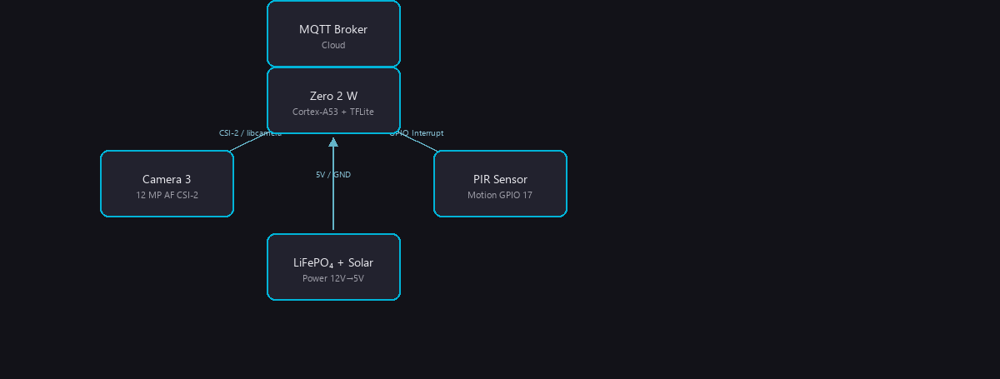

# Edge ML Camera Trap — TensorFlow Lite Wildlife Classifier

**Board:** Raspberry Pi Zero 2 W — SBC (BCM2710A1, quad-core Cortex-A53, WiFi + BLE)
**Date:** 2026-11-22

### Overview

A motion-triggered wildlife camera that runs TensorFlow Lite classification on-device (MobileNet v3) to detect and log only target species, saving SD space and cellular data. Captures 5 MP stills + 1080p clips, uploads metadata + thumbnails via MQTT over Wi-Fi. Runs weeks on a 10 Ah LiFePO₄ pack with solar top-up.

### Key Components / Peripherals

- Raspberry Pi Zero 2 W
- Pi Camera Module 3 (12 MP AF)
- PIR motion sensor (AM312)
- 10 Ah LiFePO₄ + 5W solar panel
- IP66 enclosure with IR-cut lens

### Tags

`Computer Vision` `Edge ML` `Wildlife`

---
*Posted automatically as part of DevNode Technologies' daily project showcase rotation (Pico W → Zero 2 W → Pi 3 → Pi 4 → Pi 5 → PYNQ-Z2).