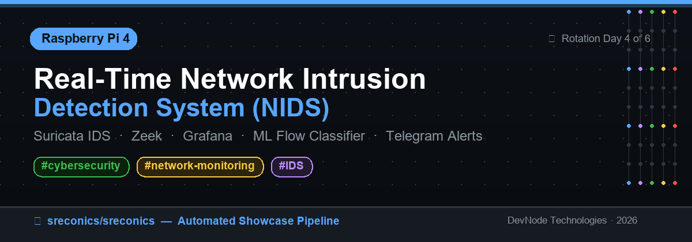
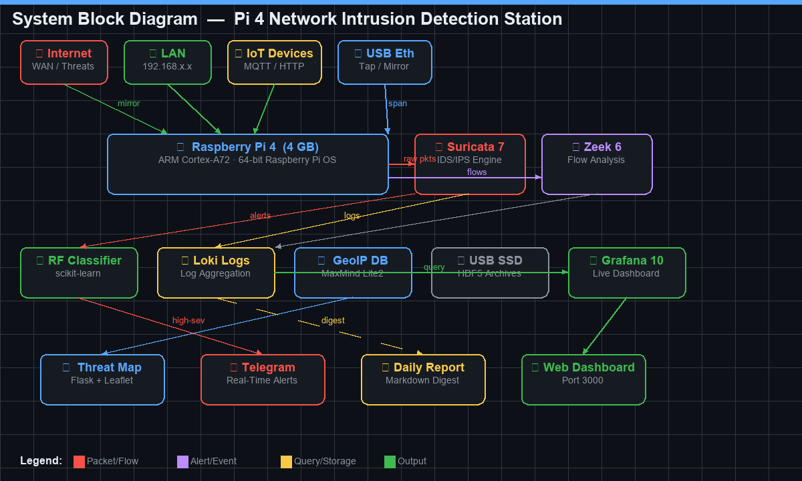

## 📋 Project Overview
> **Board:** Raspberry Pi 4 Model B (4 GB, BCM2711 Cortex-A72 @ 1.8 GHz)

This project transforms a Raspberry Pi 4 into a capable home/lab network security appliance that monitors all LAN traffic for intrusion attempts, port scans, and malware callbacks using Suricata 7 IDS and Zeek 6 network analysis framework running simultaneously on a dedicated mirror/tap interface. Flow records and alert events are ingested into a lightweight Grafana + Loki stack and displayed on a real-time live threat map that plots attacker IPs against a MaxMind GeoLite2 database, showing attack origins on an animated Leaflet.js globe. The system classifies suspicious flows using a pre-trained Random Forest model (scikit-learn, trained on the CIC-IDS2017 dataset) that runs as a local microservice (`flow_classifier.py`), triggering Telegram notifications for high-severity labels such as DoS, brute-force, or bot traffic. An automated `daily_report.py` cron job produces a full markdown digest every night summarising top attacker IPs, attack categories, most-targeted ports, and hourly heat maps — all self-hosted, no cloud dependency required.

---

## 🧰 Key Components & Peripherals

- **Raspberry Pi 4 Model B** — 4 GB RAM recommended; 64-bit Raspberry Pi OS Bookworm
- **USB 3.0 Gigabit Ethernet Adapter** — second NIC for port-mirror / tap interface (`eth1`)
- **MicroSD 32 GB+ (A2)** or USB 3.0 SSD — for log storage (Loki TSDB)
- **Suricata 7.x** — IDS/IPS engine with ET/Open Emerging Threats rule set
- **Zeek 6** — passive flow analyser for DNS, HTTP, SSL, conn logs
- **Grafana 10 + Loki 2.9** — log aggregation, dashboarding (Docker Compose)
- **scikit-learn Random Forest** — flow-level ML classifier (CIC-IDS2017 features)
- **MaxMind GeoLite2-City** — IP geolocation database (free registration)
- **Flask + Flask-SocketIO** — real-time threat map web server
- **Telegram Bot API** — push alerts for high-severity events

---

## 🖼️ System Block Diagram



---

## 📁 Program Files

| File | Purpose |
|---|---|
| [`nids_capture.py`](showcase/issue-71/nids_capture.py) | Main packet capture daemon — per-flow feature extraction, STA/LTA burst detection, Loki push |
| [`flow_classifier.py`](showcase/issue-71/flow_classifier.py) | Flask microservice that loads `model.pkl` and scores flows via REST |
| [`train_classifier.py`](showcase/issue-71/train_classifier.py) | Trains a Random Forest on CIC-IDS2017 CSVs; outputs `model.pkl` |
| [`threat_map.py`](showcase/issue-71/threat_map.py) | Flask/SocketIO server — tails Loki, GeoIP-resolves IPs, pushes events to Leaflet.js map |
| [`daily_report.py`](showcase/issue-71/daily_report.py) | Queries Loki for past 24 h, renders a Markdown threat digest |
| [`docker-compose.yml`](showcase/issue-71/docker-compose.yml) | Spins up Grafana 10 + Loki 2.9 stack with volume persistence |
| [`setup.sh`](showcase/issue-71/setup.sh) | One-shot installer — Suricata, Zeek, Docker, Python venv, systemd services |

---

## ⚡ Quick Start

```bash
# 1. Clone this repo
git clone https://github.com/SRECONICS/SRECONICS.git
cd SRECONICS/showcase/issue-71

# 2. Run the installer (requires sudo / root)
chmod +x setup.sh && sudo ./setup.sh

# 3. Set your mirror interface in /etc/nids/nids.conf
sudo nano /etc/nids/nids.conf   # set MIRROR_IFACE=eth1 (or your tap iface)

# 4. Download MaxMind GeoLite2-City.mmdb (free account required)
#    https://dev.maxmind.com/geoip/geolite2-free-geolocation-data
sudo cp GeoLite2-City.mmdb /opt/nids/

# 5. (Optional) Train the ML classifier
cd /opt/nids
# Download CIC-IDS2017 CSVs → ./cicids2017/
venv/bin/python3 train_classifier.py --data ./cicids2017 --out model.pkl

# 6. Start all services
sudo systemctl start nids-loki-grafana
sleep 10   # wait for Loki/Grafana to be healthy
sudo systemctl start nids-capture nids-classifier nids-threatmap

# 7. Open dashboards
# Grafana:    http://<pi-ip>:3000   (admin / nids_admin)
# Threat Map: http://<pi-ip>:5000
```

### Setting up a port mirror on a managed switch

```bash
# On a Cisco/TP-Link managed switch, configure a SPAN session
# to copy all LAN traffic to the Pi's mirror port.
# Then on the Pi:
sudo ip link set eth1 promisc on
sudo ip link set eth1 up
```

---

## 🏷️ Tags

`cybersecurity` · `network-monitoring` · `IDS`

---

## 🔄 Rotation

**Day 4 of 6** — Rotation: Pico W → Zero 2 W → Pi 3 → **Pi 4** → Pi 5 → PYNQ-Z2 (FPGA)

---

*Auto-generated by the sreconics showcase pipeline · 2026-11-02*
